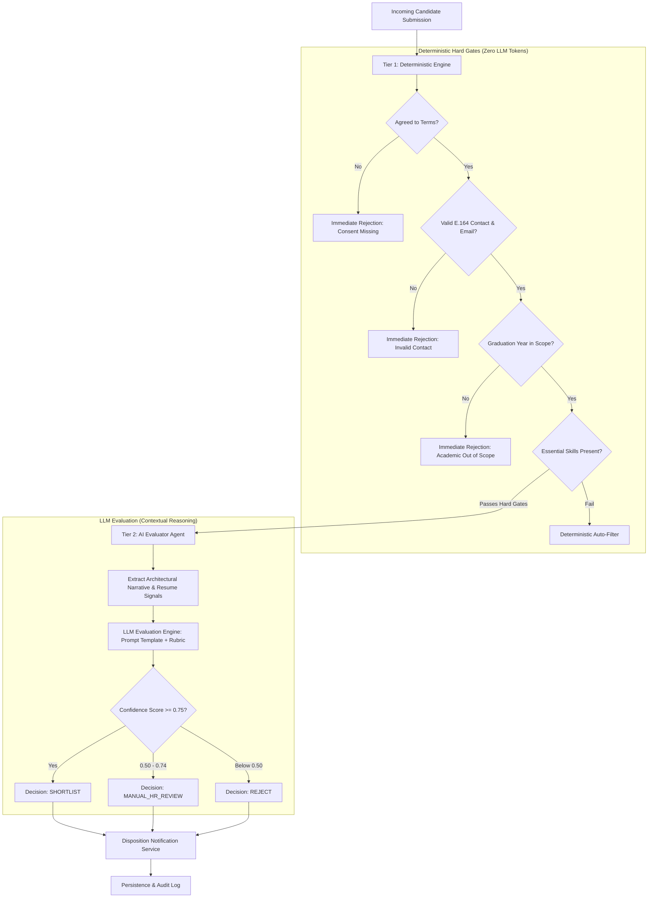
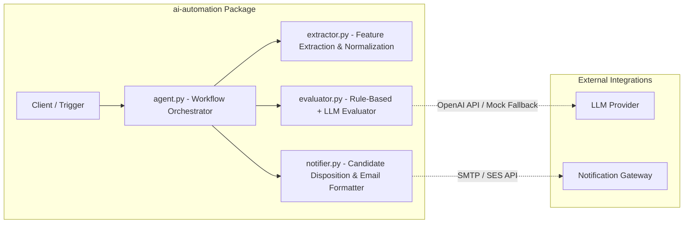

# AI Automation Architecture

> **Component:** AI Candidate Screening & Triage Pipeline  
> **Domain:** Talent Acquisition Automation for Backend Developer Roles  
> **Pattern:** Hybrid Deterministic Verification + LLM Scoring Fallback  

---

## 1. Architectural Philosophy: Deterministic vs. LLM Decisions

A critical engineering failure in naive AI implementations is delegating hard deterministic constraints (e.g., minimum working age, mandatory legal consent, required contact information) to non-deterministic Large Language Models (LLMs). This introduces hallucinations, non-reproducible outcomes, and potential regulatory liability under data protection laws.

Our architecture enforces a **two-tier decision model**:

---

## 2. Component Architecture

### 2.1 Component Responsibilities

1. **`extractor.py`**:
   - Parses the application payload into a normalized candidate profile.
   - Extracts technical skill tokens (Python, PostgreSQL, Docker, Async, FastAPI, MongoDB, Go).
   - Normalizes URLs and computes candidate academic tenure.
2. **`evaluator.py`**:
   - Executes Tier-1 deterministic rule checks (zero cost, 100% deterministic).
   - Executes Tier-2 LLM evaluation with structured output schema (Score 0–100, recommendation, strengths, weaknesses, reasoning).
   - Includes automatic heuristic fallback when no external LLM API key is provisioned.
3. **`notifier.py`**:
   - Generates personalized candidate communication based on triage stage.
   - Outputs machine-readable disposition payloads for HR tracking.
4. **`agent.py`**:
   - The central autonomous controller managing state machine transitions, retries, structured JSON telemetry, and exception handling.
