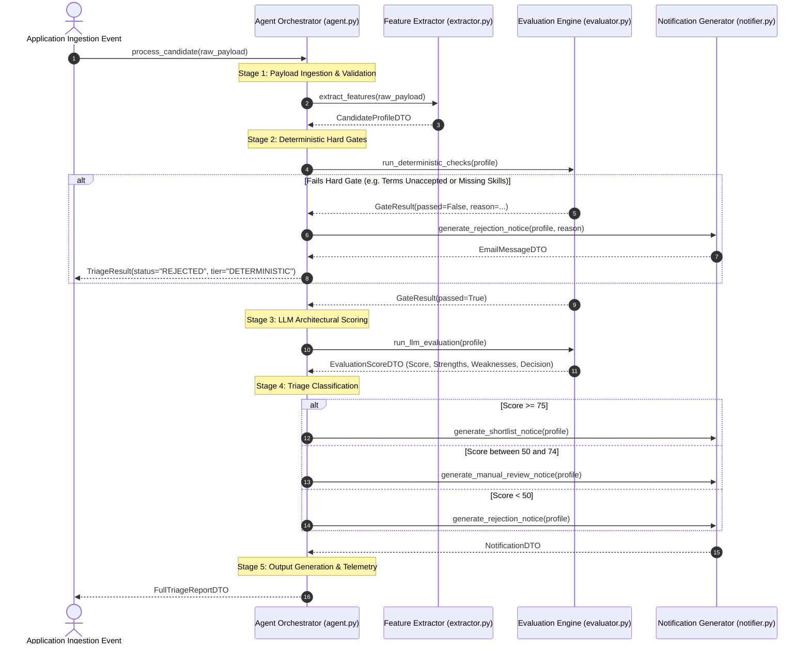

# AI Automation Workflow & Processing Specification

> **Pipeline:** Candidate Application Triage & Architectural Assessment  
> **Trigger:** Application Submission Event (`APPLICATION_SUBMITTED`)  

---

## 1. End-to-End Processing Steps

The workflow follows a 6-stage lifecycle:



---

## 2. Failure Handling & Retry Strategy

| Failure Scenario | Mitigation / Recovery Mechanism |
|---|---|
| **Malformed Ingestion Payload** | Caught at Stage 1; immediately logged as `ERROR` and routed to dead-letter queue without triggering LLM. |
| **LLM Provider Outage / 503** | Exponential backoff retry (3 attempts: 1s, 2s, 4s). If all retries fail, fall back gracefully to the heuristic rule engine with `triage_status="MANUAL_HR_REVIEW"`. |
| **API Rate Limit Exceeded (429)** | Respect `Retry-After` header with jitter. |
| **Incomplete Resume / Narrative** | Extractor flags `low_information_density=True`; penalizes contextual score without crashing. |

---

## 3. Sample Input & Output

### 3.1 Sample Ingestion Input
```json
{
  "full_name": "Harshwardhan Bhaskar",
  "email": "harshwardhan@example.com",
  "phone": "+919876543210",
  "graduation_year": 2025,
  "skills": ["Python", "FastAPI", "PostgreSQL", "Docker", "AsyncIO"],
  "agreed_to_terms": true,
  "application_statement": "Deeply interested in scalable backend architectures and API security.",
  "architectural_narrative": "Designed relational schemas with composite indexing, asyncpg connection pooling, and JWT with RBAC."
}
```

### 3.2 Sample Triage Output
```json
{
  "candidate_name": "Harshwardhan Bhaskar",
  "email": "harshwardhan@example.com",
  "deterministic_passed": true,
  "overall_score": 88,
  "decision": "SHORTLIST",
  "evaluation_tier": "LLM_ASSISTED",
  "strengths": [
    "Core backend stack matches Cynbit requirements (Python, PostgreSQL, FastAPI)",
    "Explicit architectural understanding of connection pooling and database indexing",
    "Valid graduation year for intern cohort (2025)"
  ],
  "areas_for_review": [
    "Verify depth of Redis distributed caching knowledge in technical interview"
  ],
  "notification_preview": {
    "subject": "Update on your Backend Developer Intern Application at Cynbit Technologies",
    "recipient": "harshwardhan@example.com",
    "action_required": "Schedule Technical Architecture Interview"
  }
}
```
