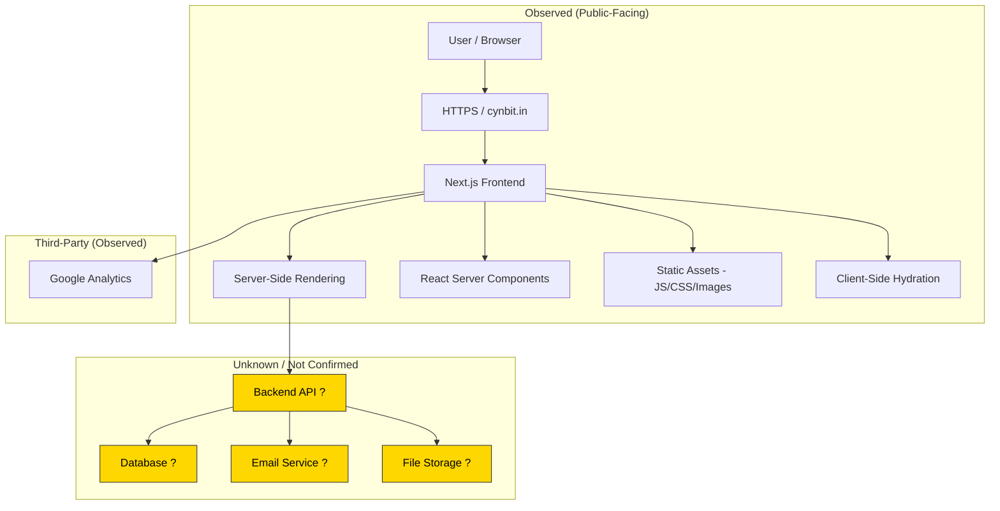

# Current Architecture Observations

## What We Know

Based on passive inspection of `cynbit.in`, here is what can be observed about the current architecture:

---

## Confirmed Components

| Component | Technology | Confidence |
|---|---|---|
| Frontend Framework | Next.js (React) | ✅ High |
| Rendering Strategy | SSR + RSC | ✅ High |
| Analytics | Google Analytics | ✅ High |
| Protocol | HTTPS | ✅ High |

## Inferred but Not Confirmed

| Component | Inference | Basis |
|---|---|---|
| Backend API | Likely Next.js API routes or external service | Common Next.js pattern |
| Database | Required for job listings and contact submissions | Standard web app pattern |
| Email Service | Likely used for contact form and job applications | Contact form presence |
| Hosting | Unknown | No definitive indicators |

## Unknown

- Authentication system architecture
- Database technology and schema
- Caching strategy
- CI/CD pipeline
- Monitoring and logging stack
- API gateway or reverse proxy configuration

---

> **Disclaimer:** This diagram represents what was observed through passive inspection. The yellow/unknown components are reasonable inferences based on common web application patterns, NOT confirmed observations. See [limitations.md](../docs/limitations.md) for full details on what could not be verified.
