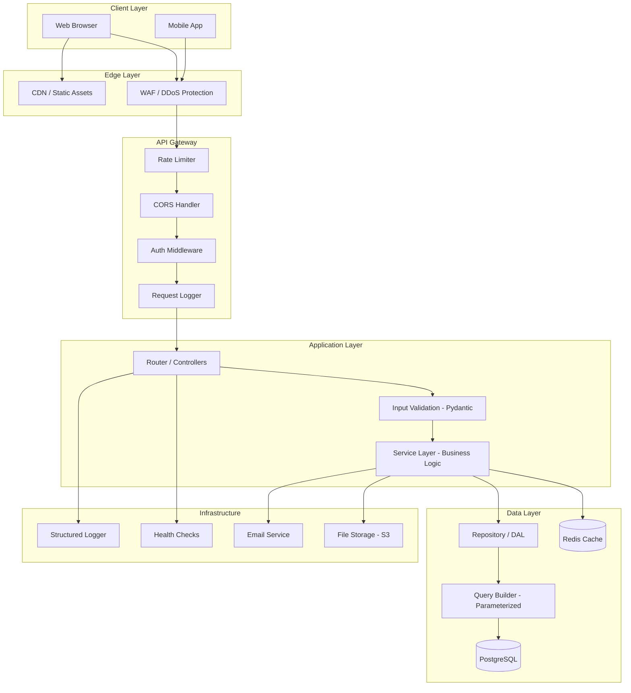
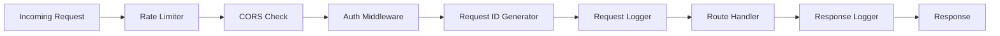
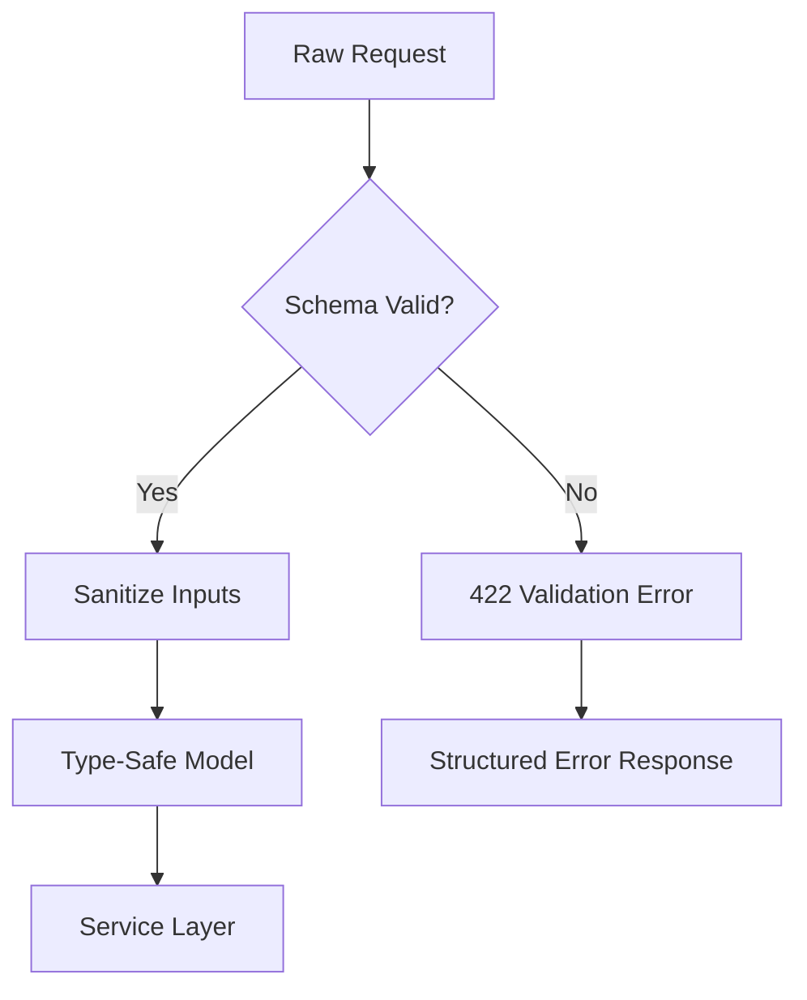
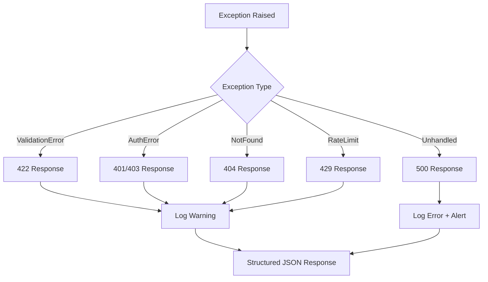
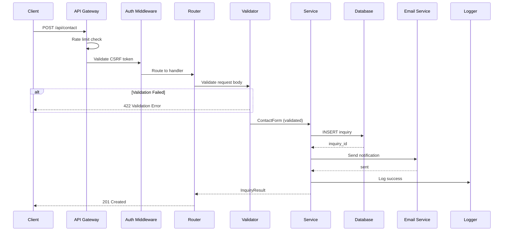
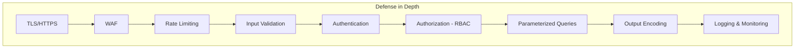
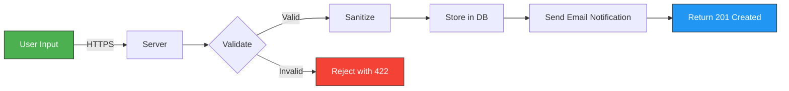
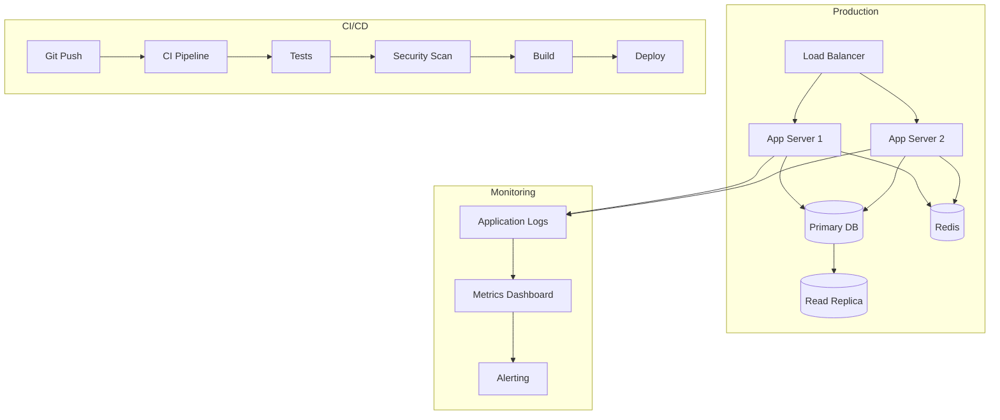

# Recommended Backend Architecture

> **Disclaimer:** This is a proposed architecture for a modern web application. It does NOT represent Cynbit Technologies' actual architecture, which was not accessible for review.

---

## Table of Contents

1. [Architecture Overview](#1-architecture-overview)
2. [System Architecture Diagram](#2-system-architecture-diagram)
3. [Layer-by-Layer Design](#3-layer-by-layer-design)
4. [Request Flow](#4-request-flow)
5. [Security Architecture](#5-security-architecture)
6. [Data Flow](#6-data-flow)
7. [Deployment Architecture](#7-deployment-architecture)
8. [Technology Recommendations](#8-technology-recommendations)

---

## 1. Architecture Overview

The recommended architecture follows a **layered, service-oriented design** with clear separation of concerns:

| Layer | Responsibility |
|---|---|
| **API Gateway** | Request routing, rate limiting, CORS, authentication |
| **Controller/Router** | Request handling, input deserialization, response formatting |
| **Validation** | Input validation and sanitization |
| **Service** | Business logic, orchestration |
| **Repository/DAL** | Database access, query execution |
| **Infrastructure** | Logging, monitoring, caching, external services |

---

## 2. System Architecture Diagram



---

## 3. Layer-by-Layer Design

### 3.1 API Gateway / Middleware Layer



**Responsibilities:**
- **Rate Limiting:** Prevent abuse — per-IP, per-user, per-endpoint limits
- **CORS:** Allow only trusted origins
- **Authentication:** Validate JWT tokens, session cookies
- **Request ID:** Generate unique correlation ID for tracing
- **Logging:** Log request metadata (method, path, status, duration)

### 3.2 Validation Layer

All inputs must be validated before reaching business logic:



**Recommendations:**
- Use Pydantic models for automatic type validation
- Validate on the server side, never trust client-side validation alone
- Return structured, consistent error responses
- Strip/escape HTML from text inputs

### 3.3 Service Layer

The service layer contains all business logic and orchestrates operations:

```python
# Conceptual service pattern
class ContactService:
    def __init__(self, repo: ContactRepository, email: EmailService):
        self.repo = repo
        self.email = email
    
    async def submit_inquiry(self, data: ContactForm) -> InquiryResult:
        # 1. Save to database
        inquiry = await self.repo.create(data)
        # 2. Send notification email
        await self.email.send_notification(inquiry)
        # 3. Return result
        return InquiryResult(id=inquiry.id, status="submitted")
```

### 3.4 Data Access Layer

**Principles:**
- Use parameterized queries exclusively (prevents SQL injection)
- Implement repository pattern for testability
- Use connection pooling for performance
- Implement database migrations for schema changes

### 3.5 Exception Handling



**Rules:**
- Never expose stack traces in production
- Log full error details server-side
- Return user-friendly error messages client-side
- Use correlation IDs to link user-facing errors to server logs

---

## 4. Request Flow

Complete request lifecycle for a contact form submission:



---

## 5. Security Architecture



### Security Controls by Layer

| Layer | Controls |
|---|---|
| **Transport** | TLS 1.3, HSTS, certificate pinning |
| **Edge** | WAF rules, DDoS protection, IP blocking |
| **Application** | Rate limiting, CORS, CSP headers |
| **Authentication** | JWT/session tokens, MFA, account lockout |
| **Authorization** | RBAC, resource-level permissions |
| **Data** | Parameterized queries, encryption at rest, input sanitization |
| **Output** | HTML encoding, JSON serialization, Content-Type headers |
| **Monitoring** | Structured logging, alerting, audit trail |

---

## 6. Data Flow

### Contact Form Data Flow



### Data at Rest

| Data | Storage | Encryption | Retention |
|---|---|---|---|
| Contact inquiries | PostgreSQL | AES-256 at rest | Per privacy policy |
| User credentials | PostgreSQL | bcrypt/Argon2id (hashed) | Account lifetime |
| Session tokens | Redis | In-memory | Configurable TTL |
| Uploaded files | Object storage (S3) | Server-side encryption | Per policy |
| Logs | Log aggregator | TLS in transit | 90 days |

---

## 7. Deployment Architecture



---

## 8. Technology Recommendations

| Component | Recommended | Rationale |
|---|---|---|
| **Backend Framework** | FastAPI (Python) or Next.js API Routes | Type safety, async support, auto-documentation |
| **Database** | PostgreSQL | ACID compliance, JSON support, mature ecosystem |
| **Cache** | Redis | High performance, pub/sub, session storage |
| **ORM** | SQLAlchemy (Python) or Prisma (Node.js) | Type-safe queries, migration support |
| **Auth** | JWT + refresh tokens | Stateless, scalable |
| **Password Hashing** | bcrypt or Argon2id | Industry standard, configurable cost factor |
| **Validation** | Pydantic (Python) or Zod (Node.js) | Runtime type validation, auto-serialization |
| **Logging** | Structured JSON logging | Machine-parseable, easy aggregation |
| **Monitoring** | Prometheus + Grafana | Open source, industry standard |
| **Email** | SendGrid or AWS SES | Reliable delivery, templates, analytics |
| **File Storage** | AWS S3 or compatible | Scalable, durable, cost-effective |
| **CI/CD** | GitHub Actions | Native GitHub integration, free tier |

---

> **Note:** These are recommendations for a greenfield or modernization project. Actual technology choices should consider team expertise, existing infrastructure, budget, and specific requirements.
