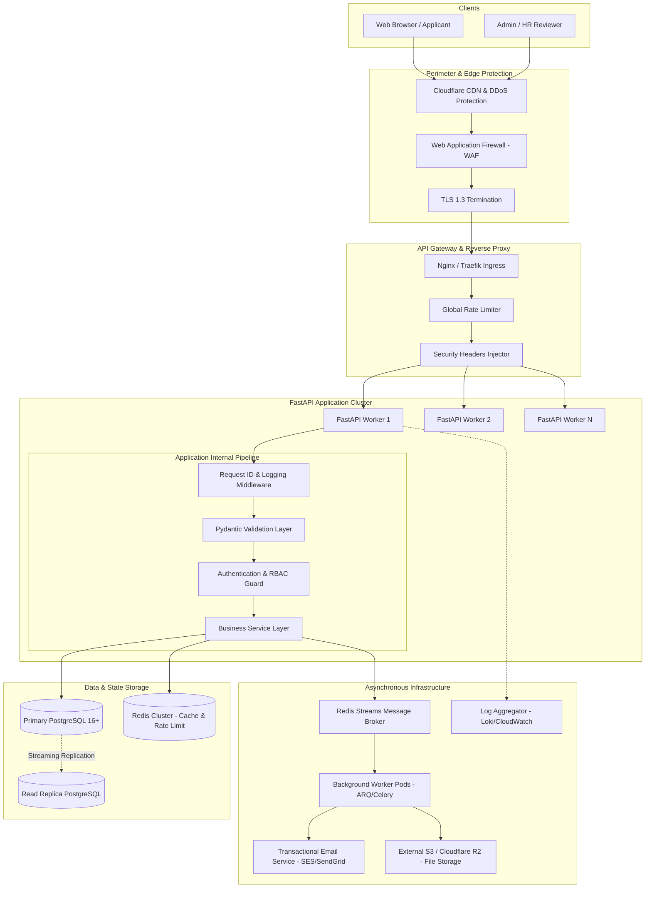
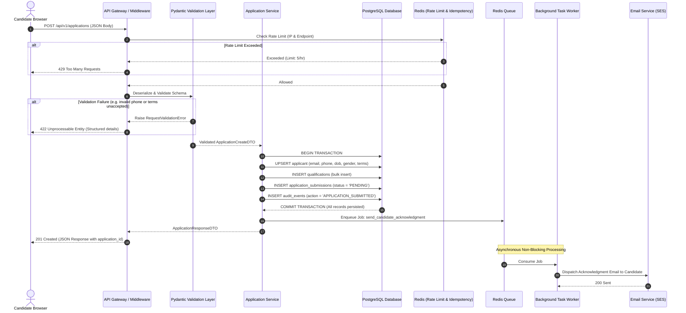
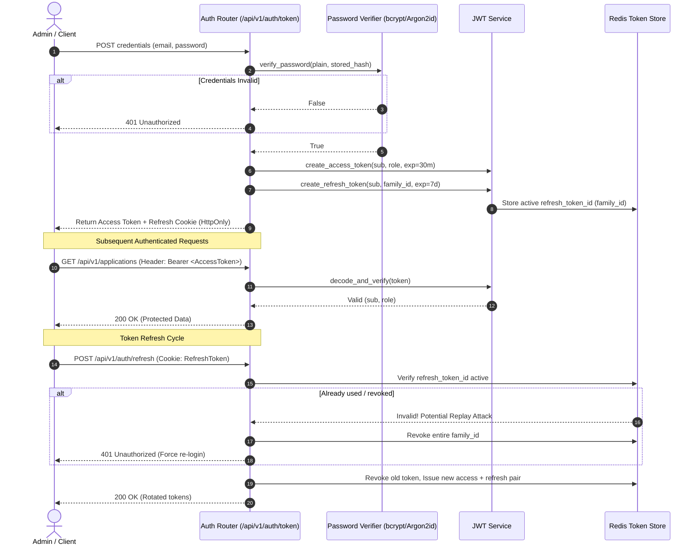

# System Architecture & Flow Diagrams

> **Architecture Document:** Cynbit Backend Reference Architecture  
> **Visual Modeling:** Mermaid Specification  

---

## 1. End-to-End System Architecture

---

## 2. Career Application Submission Sequence Flow

This diagram illustrates the atomic transactional flow when a candidate submits the career application:

---

## 3. JWT Authentication & Refresh Token Rotation Flow

