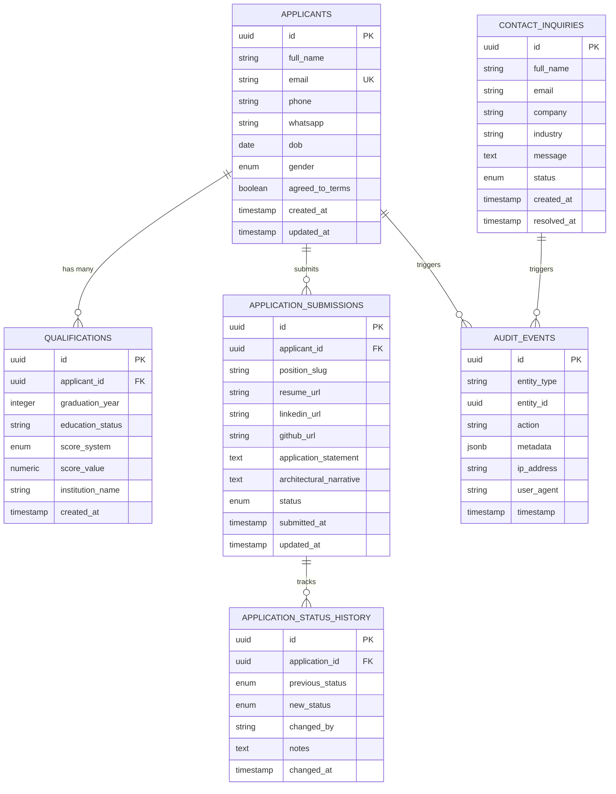

# Proposed Backend Architecture & Relational Database Design

> **Document Status:** Proposed Engineering Blueprint (Not Cynbit's proprietary codebase)  
> **Database Engine:** PostgreSQL 16+  
> **Framework:** FastAPI / Async Python 3.12+  

---

## 1. Relational Database Schema Design (PostgreSQL)

To model the complete workflow observed on the Cynbit platform—specifically the Careers Application Form (`/careers/backend-developer-intern`) and the Contact Inquiry Hub (`/contact`)—the following normalized schema is proposed:



---

## 2. Table Specifications & Constraints

### 2.1 Table: `applicants`
Stores candidate profile data mapped directly to observed DOM inputs.

```sql
CREATE TABLE applicants (
    id UUID PRIMARY KEY DEFAULT gen_random_uuid(),
    full_name VARCHAR(100) NOT NULL,
    email VARCHAR(254) NOT NULL,
    phone VARCHAR(20) NOT NULL,
    whatsapp VARCHAR(20) NOT NULL,
    dob DATE NOT NULL,
    gender VARCHAR(30) NOT NULL CHECK (gender IN ('Male', 'Female', 'Other', 'Prefer not to say')),
    agreed_to_terms BOOLEAN NOT NULL DEFAULT FALSE,
    created_at TIMESTAMPTZ NOT NULL DEFAULT NOW(),
    updated_at TIMESTAMPTZ NOT NULL DEFAULT NOW(),
    CONSTRAINT uq_applicants_email UNIQUE (email),
    CONSTRAINT chk_terms_agreed CHECK (agreed_to_terms = TRUE)
);

CREATE INDEX idx_applicants_email ON applicants(email);
CREATE INDEX idx_applicants_phone ON applicants(phone);
```

### 2.2 Table: `qualifications`
Stores dynamic repeatable qualifications ("Add Another Qualification").

```sql
CREATE TABLE qualifications (
    id UUID PRIMARY KEY DEFAULT gen_random_uuid(),
    applicant_id UUID NOT NULL REFERENCES applicants(id) ON DELETE CASCADE,
    graduation_year INT NOT NULL CHECK (graduation_year BETWEEN 1980 AND 2035),
    education_status VARCHAR(50) NOT NULL,
    score_system VARCHAR(30) NOT NULL CHECK (score_system IN ('CGPA_10', 'CGPA_4', 'PERCENTAGE_100')),
    score_value NUMERIC(5,2) NOT NULL,
    institution_name VARCHAR(200),
    created_at TIMESTAMPTZ NOT NULL DEFAULT NOW()
);

CREATE INDEX idx_qualifications_applicant ON qualifications(applicant_id);
```

### 2.3 Table: `application_submissions`
Tracks individual role applications submitted by an applicant.

```sql
CREATE TABLE application_submissions (
    id UUID PRIMARY KEY DEFAULT gen_random_uuid(),
    applicant_id UUID NOT NULL REFERENCES applicants(id) ON DELETE RESTRICT,
    position_slug VARCHAR(100) NOT NULL,
    resume_url TEXT NOT NULL,
    linkedin_url TEXT,
    github_url TEXT,
    application_statement TEXT NOT NULL,
    architectural_narrative TEXT,
    status VARCHAR(30) NOT NULL DEFAULT 'PENDING' 
        CHECK (status IN ('PENDING', 'REVIEWING', 'SHORTLISTED', 'REJECTED', 'OFFERED')),
    submitted_at TIMESTAMPTZ NOT NULL DEFAULT NOW(),
    updated_at TIMESTAMPTZ NOT NULL DEFAULT NOW(),
    CONSTRAINT uq_applicant_position UNIQUE (applicant_id, position_slug)
);

CREATE INDEX idx_applications_position_status ON application_submissions(position_slug, status);
CREATE INDEX idx_applications_submitted ON application_submissions(submitted_at DESC);
```

### 2.4 Table: `contact_inquiries`
Models the Contact Inquiry Hub (`/contact`).

```sql
CREATE TABLE contact_inquiries (
    id UUID PRIMARY KEY DEFAULT gen_random_uuid(),
    full_name VARCHAR(100) NOT NULL,
    email VARCHAR(254) NOT NULL,
    company VARCHAR(200),
    industry VARCHAR(100),
    message TEXT NOT NULL,
    status VARCHAR(30) NOT NULL DEFAULT 'NEW' 
        CHECK (status IN ('NEW', 'IN_PROGRESS', 'RESOLVED', 'SPAM')),
    created_at TIMESTAMPTZ NOT NULL DEFAULT NOW(),
    resolved_at TIMESTAMPTZ
);

CREATE INDEX idx_contact_status_created ON contact_inquiries(status, created_at DESC);
```

### 2.5 Table: `audit_events`
Immutable security and data audit trail for compliance with data protection laws.

```sql
CREATE TABLE audit_events (
    id UUID PRIMARY KEY DEFAULT gen_random_uuid(),
    entity_type VARCHAR(50) NOT NULL,
    entity_id UUID NOT NULL,
    action VARCHAR(50) NOT NULL,
    metadata JSONB,
    ip_address INET,
    user_agent TEXT,
    timestamp TIMESTAMPTZ NOT NULL DEFAULT NOW()
);

CREATE INDEX idx_audit_entity ON audit_events(entity_type, entity_id);
CREATE INDEX idx_audit_timestamp ON audit_events(timestamp DESC);
```

---

## 3. REST API Contract Specifications

All API endpoints follow RESTful conventions, adhere to standard HTTP status codes, and return JSON responses wrapped in a uniform schema envelope.

### 3.1 Endpoint Summary

| Method | Route | Description | Auth Required | Rate Limit |
|---|---|---|---|---|
| `GET` | `/api/v1/health` | Service health and database liveness | None | None |
| `POST` | `/api/v1/applications` | Submit new job application with qualifications | None | 5 / hr / IP |
| `GET` | `/api/v1/applications/{id}` | Retrieve application details | Bearer JWT (Admin/HR) | 100 / min |
| `PATCH` | `/api/v1/applications/{id}/status` | Update candidate hiring stage | Bearer JWT (Admin/HR) | 60 / min |
| `POST` | `/api/v1/contacts` | Submit contact inquiry | None | 5 / hr / IP |
| `GET` | `/api/v1/contacts` | List inquiries with cursor pagination | Bearer JWT (Admin) | 60 / min |
| `POST` | `/api/v1/auth/token` | Obtain JWT access and refresh tokens | None | 5 / 15 min |

### 3.2 Standard Response Envelopes

#### Success Envelope (`200 OK` / `201 Created`):
```json
{
  "success": true,
  "data": {
    "application_id": "8f1b2c4e-1234-5678-90ab-cdef12345678",
    "status": "PENDING",
    "submitted_at": "2026-11-01T05:00:00Z"
  },
  "request_id": "req_a1b2c3d4"
}
```

#### Error Envelope (`400`, `401`, `403`, `404`, `422`, `429`, `500`):
```json
{
  "success": false,
  "error": {
    "code": "VALIDATION_ERROR",
    "message": "Invalid input provided",
    "details": [
      {
        "field": "dob",
        "message": "Candidate must be at least 16 years old"
      }
    ],
    "request_id": "req_a1b2c3d4"
  }
}
```
